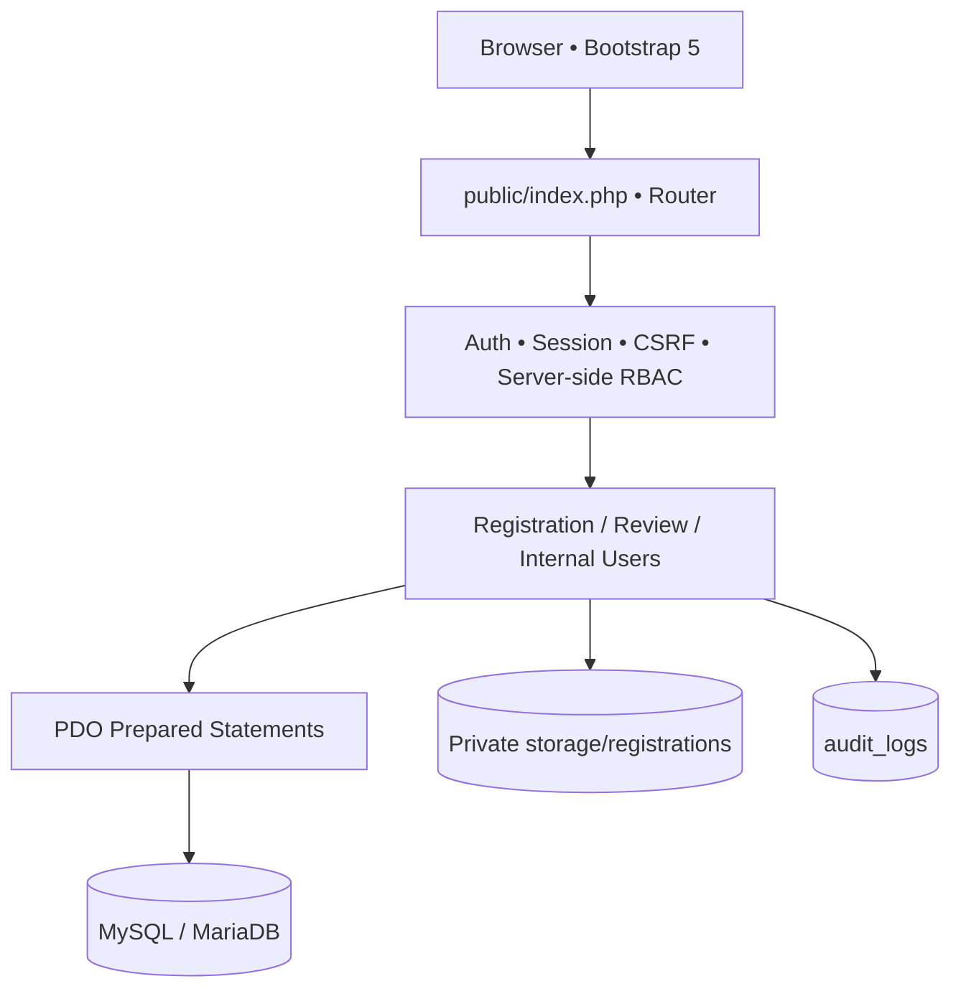
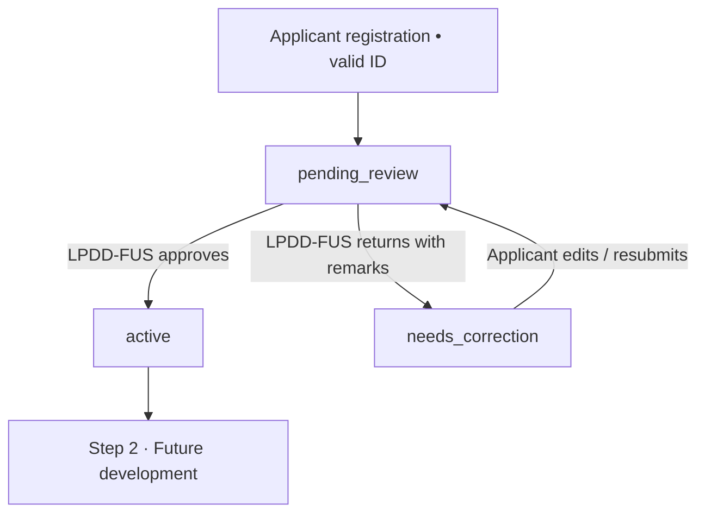

# DENR FP-OMS — Architecture and Schema Overview

## Request flow

## Step 1 state machine

`users.status` is the authoritative account-activation state. Each correction increments `applicant_registrations.revision` and a review record stores the reviewed revision. Historical uploads and decisions are retained for traceability. A reviewer cannot approve a registration that is no longer pending.

## Core data entities

| Entity | Purpose | Relationship |
|---|---|---|
| `offices` | Regional / PENRO / CENRO hierarchy | users.office_id optional |
| `users` | Account identity, password hash, activation status | 1:N to user_roles |
| `roles` | Known functional roles | 1:N to user_roles |
| `user_roles` | Flexible many-to-many RBAC assignment | PK(user_id, role_id) |
| `applicant_registrations` | One-time applicant company/contact details | 1:1 users |
| `registration_documents` | Immutable private-upload revisions | N:1 registrations |
| `registration_reviews` | LPDD-FUS approval/correction decisions | N:1 registrations |
| `login_attempts` | Login rate limiting (per email hash/IP) | Independent audit data |
| `audit_logs` | Recorded security/business actions | actor_user_id nullable |

**Scaffold only in `002_future_workflow.sql`:** `permit_applications`, `application_documents`, `workflow_actions`, `permit_records`. Additional workflow entities (RRDC sessions, TOR templates, signatures, assignments, notifications) will be designed when Steps 2–11 are implemented and their detailed business rules approved.

## Authorization matrix — Phase 1

| Feature | Public | Applicant | LPDD-FUS | RICTU Admin | Other Internal |
|---|:---:|:---:|:---:|:---:|:---:|
| Register new applicant | ✓ | — | — | — | — |
| Sign in and change password | ✓* | ✓ | ✓ | ✓ | ✓ |
| View own registration/status | — | ✓ | — | — | — |
| Edit own registration if correction requested | — | ✓ | — | — | — |
| Review registrations and activate applicant | — | — | ✓ | — | — |
| Download applicant registration docs | — | Own | ✓ | ✓ | — |
| Provision internal users | — | — | — | ✓ | — |
| File permit application (Step 2) | — | Not implemented | — | — | — |

*Sign-in is public; password changes require an authenticated user.

## Design trade-offs / controls

- A dependency-light PHP architecture was chosen for straightforward DENR hosting and PHP 8 familiarity. A framework/ORM and Composer packages can be introduced in later phases.
- Private document storage is physically outside `/public`, with randomized filenames, file-signature checks and explicit read authorization.
- Initial staff roles are provisioned by RICTU. Super Administrator does **not** implicitly override LPDD-FUS business decisions in this release.
- Server sessions are SameSite=Lax, HttpOnly and HTTPS-Secure when behind HTTPS; production deployments must enforce HTTPS and protect session storage.
- Each sensitive POST operation uses CSRF validation. SQL uses prepared statements. Login attempts are throttled based on server-visible IP and email hash (a future scheduled cleanup job should prune old attempts).
- UI uses Bootstrap 5 from a CDN. Before deployment on restricted networks, host a vetted local copy and change CSP to self-hosted-only.
