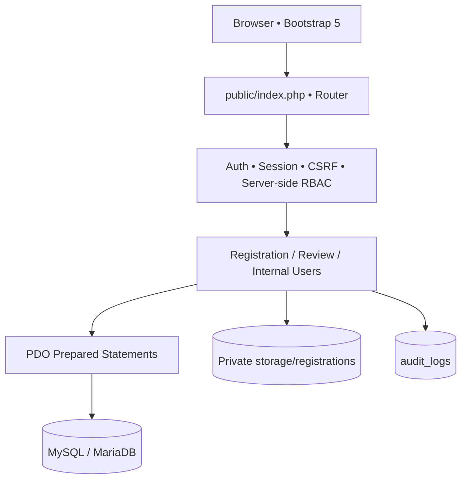
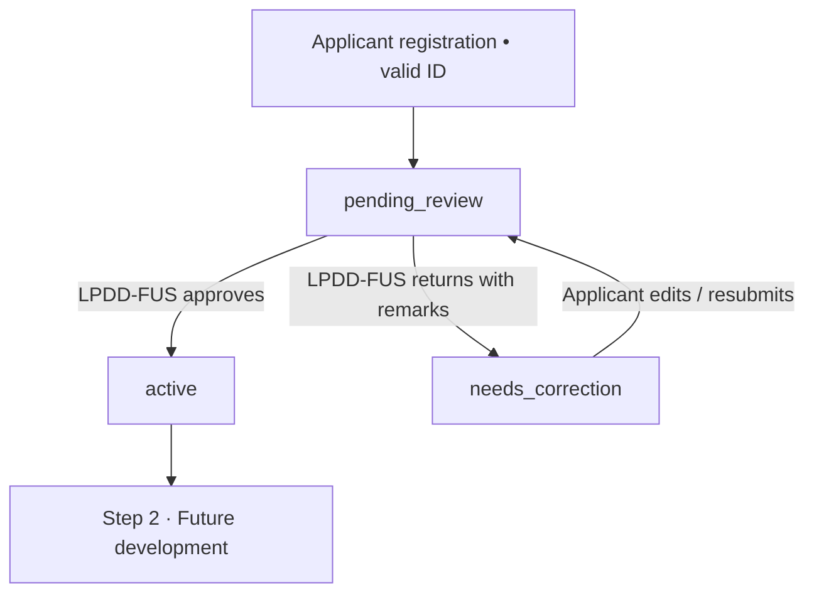

# DENR FP-OMS — Architecture and Schema Overview

## Request flow

## Step 1 state machine

`users.status` is the authoritative account-activation state. Each correction increments `applicant_registrations.revision` and a review record stores the reviewed revision. Historical uploads and decisions are retained for traceability. Registration documents store one row per uploaded file, with a nullable `id_type` added by `007_registration_id_types.sql`. All uploaded files across revisions are shown (rather than only one per category); legacy IDs without a recorded type remain identifiable. A new submission requires at least one Valid ID with a chosen ID type; corrected submissions may add further IDs and supporting documents. A reviewer cannot approve a registration that is no longer pending.

## Core data entities

| Entity | Purpose | Relationship |
|---|---|---|
| `offices` | Regional / PENRO / CENRO hierarchy | users.office_id optional |
| `users` | Account identity, password hash, activation status | 1:N to user_roles |
| `roles` | Known functional roles | 1:N to user_roles |
| `user_roles` | Flexible many-to-many RBAC assignment | PK(user_id, role_id) |
| `applicant_registrations` | One-time applicant company/contact details | 1:1 users |
| `users` pending_setup rows | Pending staff identities and office-reference contacts in the master accounts table | Cannot authenticate until administrator activates in-place |
| `registration_documents` | Immutable private-upload revisions | N:1 registrations |
| `registration_reviews` | LPDD-FUS approval/correction decisions | N:1 registrations |
| `login_attempts` | Login rate limiting (per email hash/IP) | Independent audit data |
| `audit_logs` | Recorded security/business actions | actor_user_id nullable |

**Scaffold only in `002_future_workflow.sql`:** `permit_applications`, `application_documents`, `workflow_actions`, `permit_records`. Additional workflow entities (RRDC sessions, TOR templates, signatures, assignments, notifications) will be designed when Steps 2–11 are implemented and their detailed business rules approved.

## RICTU User Management — Single `users` Table

* The RICTU Configuration → User Management menu is visible only to authorized active Super Administrators; all POST routes have CSRF and server-side authorization checks.
* Migration `008_user_management.sql` originally staged the 34 personnel designations from the October 21, 2026 form; migration `009_merge_designations_into_users.sql` consolidates these records into the existing `users` table and drops `user_designations` **only after a successful reconciliation check**.
* Unique source identifiers, original office contact/reference emails, notes and office/station are preserved in `users.source_key`, `users.reference_email`, `users.designation_notes`, `users.office_station`. An office reference email is not automatically a login email.
* The `pending_setup` status allows staff to be visible in `users` with null `email` and `password_hash`. Login/session code excludes this status entirely. Administrators activate these rows **in place** by assigning unique login email, role and strong temporary password, forcing a change at first sign-in.
* Existing accounts (including the administrator) preserve their IDs, hashed passwords and references; missing `user_roles` rows are restored using verified designation roles, never replacing other existing roles. Importing 009 is a one-time data migration, not a new account signup.
* A RICTU administrator can edit active/suspended internal users, manually add users absent from the consolidated list, reset temporary passwords and update office/contact information. Self-demotion, self-suspension and removal of the last active administrator are blocked. All these operations are audited.
* Designated `gis_focal` is present as an internal role, but future permit workflow modules do not become active merely because the role exists.
* `users.email` is the unique login address; `users.reference_email` is the office/reference address supplied in the personnel form. User Management displays both separately. A reference address is eligible as a **setup suggestion** only if it appears for exactly one internal person across all users and has no existing login assignment. This is not proof of mailbox ownership, which the administrator must verify. Reference addresses used by multiple personnel are rejected as new personal logins in account creation, activation and email editing.
* `010_restore_office_email_references.sql` is an optional idempotent data-repair migration after 009. It restores only missing `reference_email` values for source-keyed pending staff; it never populates login credentials or activates accounts. The supplied October 26 export already contains the reference addresses.

## Authorization matrix — Phase 1

| Feature | Public | Applicant | LPDD-FUS | RICTU Admin | Other Internal |
|---|:---:|:---:|:---:|:---:|:---:|
| Register new applicant | ✓ | — | — | — | — |
| Sign in and change password | ✓* | ✓ | ✓ | ✓ | ✓ |
| View own registration/status | — | ✓ | — | — | — |
| Edit own registration if correction requested | — | ✓ | — | — | — |
| Review registrations and activate applicant | — | — | ✓ | — | — |
| Download applicant registration docs | — | Own | ✓ | ✓ | — |
| Provision internal users | — | — | — | ✓ | — |
| File permit application (Step 2) | — | Not implemented | — | — | — |

*Sign-in is public; password changes require an authenticated user.

## Design trade-offs / controls

- A dependency-light PHP architecture was chosen for straightforward DENR hosting and PHP 8 familiarity. A framework/ORM and Composer packages can be introduced in later phases.
- Private document storage is physically outside `/public`, with randomized filenames, file-signature checks and explicit read authorization.
- Initial staff roles are provisioned by RICTU. Super Administrator does **not** implicitly override LPDD-FUS business decisions in this release.
- Server sessions are SameSite=Lax, HttpOnly and HTTPS-Secure when behind HTTPS; production deployments must enforce HTTPS and protect session storage.
- Each sensitive POST operation uses CSRF validation. SQL uses prepared statements. Login attempts are throttled based on server-visible IP and email hash (a future scheduled cleanup job should prune old attempts).
- UI uses Bootstrap 5 from a CDN. Before deployment on restricted networks, host a vetted local copy and change CSP to self-hosted-only.
